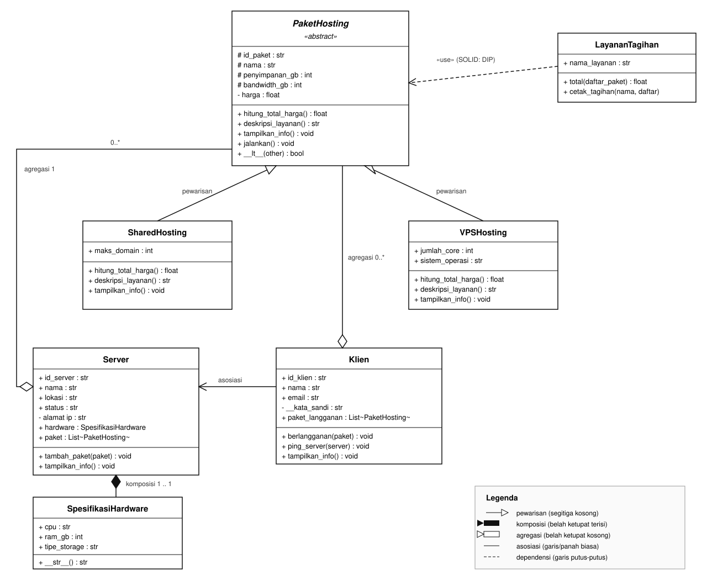
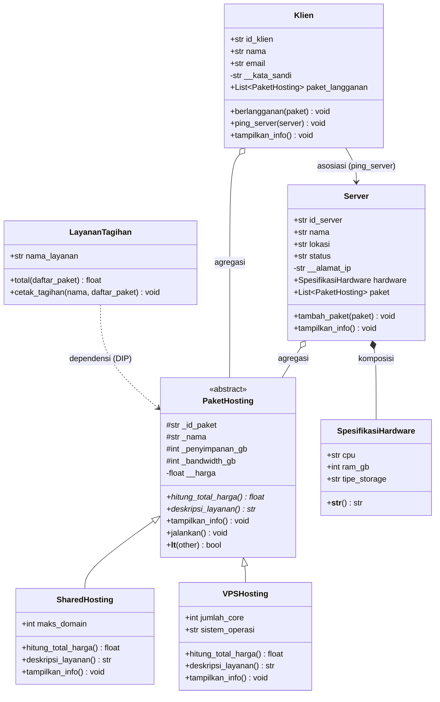

# Sistem Manajemen Hosting Server

Program Python berbasis OOP untuk mensimulasikan pengelolaan layanan hosting: paket hosting, server, klien, langganan, penagihan, serta relasi antar objeknya. Program ini merupakan pengembangan dari posttest sebelumnya (inheritance) dengan tambahan **abstraksi**, **polimorfisme**, **tiga relasi UML**, dan **prinsip SOLID (DIP)**.

Konsep OOP yang diterapkan:

- Class dan object
- Atribut kelas dan atribut instance
- Encapsulation (Public, Protected `_nama`, Private `__nama`)
- Property, getter, dan setter
- Inheritance (`super().__init__`, method overriding, atribut unik subclass)
- Abstraksi (`ABC`, `@abstractmethod`, method konkret)
- Polimorfisme (pewarisan, duck typing, operator overloading)
- Relasi UML (asosiasi, agregasi, komposisi)
- SOLID: Dependency Inversion Principle (DIP)
- Validasi input menggunakan `ValueError`

---

## 1. Struktur Folder

```text
posttest3-pbo/
├── main.py
├── README.md
├── class_diagram.svg           # gambar Class Diagram (UML)
└── sistem_manajemen_hosting_server/
    ├── __init__.py
    └── models/
        ├── __init__.py
        ├── paket_hosting.py      # abstract class (ABC)
        ├── shared_hosting.py     # subclass 1
        ├── vps_hosting.py        # subclass 2
        ├── hardware.py           # part untuk komposisi
        ├── server.py             # whole: komposisi + agregasi
        ├── klien.py              # agregasi + asosiasi
        └── penagihan.py          # SOLID: DIP
```

Cara menjalankan:

```bash
python main.py
```

---

## 2. Class Diagram



> Gambar di atas dirender dari `class_diagram.svg`.

Versi Mermaid (dapat dirender langsung oleh GitHub / VS Code):



### 2.1 Penjelasan Relasi

| Relasi        | Notasi                                                 | Kelas                               | Kode pembuktian                                                          | Alasan                                                                                                                                                                |
| :------------ | :----------------------------------------------------- | :---------------------------------- | :----------------------------------------------------------------------- | :-------------------------------------------------------------------------------------------------------------------------------------------------------------------- |
| **Pewarisan** | `PaketHosting <\|-- SharedHosting`, `<\|-- VPSHosting` | `PaketHosting` → dua subclass       | `super().__init__(...)` di `shared_hosting.py:9` dan `vps_hosting.py:12` | Subclass mewarisi seluruh atribut dan method dasar, lalu menambah atribut/behavior sendiri                                                                            |
| **Komposisi** | `Server` ◆── `SpesifikasiHardware`                     | `Server` memiliki `hardware`        | `self.hardware = SpesifikasiHardware(...)` di `server.py:18`             | Objek hardware dibuat **di dalam** `Server.__init__()`, tidak bisa disuntikkan dari luar. Hardware tidak punya makna tanpa Server, jadi siklus hidupnya terikat penuh |
| **Agregasi**  | `Server` ◇── `PaketHosting`                            | `Server` menampung `paket`          | `server.tambah_paket(paket)` di `server.py:52`                           | Paket dibuat **di luar** Server, lalu dimasukkan ke list. Paket tetap hidup walau Server dihapus, dan satu paket bisa dipakai lebih dari satu whole                   |
| **Agregasi**  | `Klien` ◇── `PaketHosting`                             | `Klien` menyimpan `paket_langganan` | `klien.berlangganan(paket)` di `klien.py:46`                             | Objek paket dibuat sistem, bukan oleh Klien. Klien hanya menyimpan referensi; paket bisa berhenti berlangganan tanpa ikut musnah                                      |
| **Asosiasi**  | `Klien` ──> `Server`                                   | `Klien` mengenal `Server`           | `klien.ping_server(server)` di `klien.py:55`                             | Server hanya **parameter method** dan tidak disimpan sebagai atribut. Klien memakai Server sesaat tanpa memiliki atau mengatur siklus hidupnya                        |

**Agregasi vs komposisi:** keduanya menyimpan objek lain, tetapi bedanya pada **siapa yang membuat dan siapa yang menentukan hidup-mati**. `Server` membuat `SpesifikasiHardware` sendiri → komposisi. `Server` dan `Klien` hanya **menerima** objek `PaketHosting` yang sudah dibuat pihak lain → agregasi.

---

## 3. Penerapan Abstraksi

| Komponen               | Nama                                              | Lokasi                                            |
| :--------------------- | :------------------------------------------------ | :------------------------------------------------ |
| Abstract class         | `PaketHosting(ABC)`                               | `paket_hosting.py:7`                              |
| Abstract method 1      | `hitung_total_harga()`                            | `paket_hosting.py:57`                             |
| Abstract method 2      | `deskripsi_layanan()`                             | `paket_hosting.py:62`                             |
| Method konkret bersama | `jalankan()`                                      | `paket_hosting.py:68`                             |
| Method konkret lain    | `tampilkan_info()`                                | `paket_hosting.py:78`                             |
| Subclass 1             | `SharedHosting` (implement kedua abstract method) | `shared_hosting.py:14` dan `shared_hosting.py:19` |
| Subclass 2             | `VPSHosting` (implement kedua abstract method)    | `vps_hosting.py:18` dan `vps_hosting.py:25`       |

`PaketHosting.jalankan()` adalah method konkret yang **dipakai bersama** semua subclass tanpa ditulis ulang. Perilaku tiap paket tetap berbeda karena `jalankan()` memanggil `deskripsi_layanan()` dan `hitung_total_harga()` milik subclass masing-masing.

**Bukti abstract class tidak bisa diinstansiasi** (`main.py:33`):

```python
try:
    PaketHosting("ABS-01", "Paket Abstrak", 10, 100, 50000)
except TypeError as error:
    print(f"[BUKTI] TypeError: {error}")
```

Hasil di Python 3.12:

```text
[BUKTI] TypeError: Can't instantiate abstract class PaketHosting without an implementation for abstract methods 'deskripsi_layanan', 'hitung_total_harga'
```

---

## 4. Penerapan Polimorfisme

### 4.1 Polimorfisme via Pewarisan

Method yang di-override: `tampilkan_info()` dan `hitung_total_harga()`.

| Kelas           | Perilaku `hitung_total_harga()`                        |
| :-------------- | :----------------------------------------------------- |
| `SharedHosting` | `harga * (1 + pajak)`                                  |
| `VPSHosting`    | `(harga + jumlah_core × biaya_per_core) × (1 + pajak)` |

Dipanggil lewat satu loop berisi objek subclass berbeda (`main.py:66-67`):

```python
for paket in daftar_paket:      # isinya SharedHosting + VPSHosting
    paket.tampilkan_info()
```

Tidak ada `if/elif` berisi `type()`/`isinstance()` untuk memilih tampilan. Setiap objek menjalankan method versinya sendiri.

### 4.2 Duck Typing

`Server` dan `Klien` **tidak saling mewarisi**, tetapi keduanya punya method `tampilkan_info()`. Fungsi `cetak_entitas()` (`main.py:17`) hanya memanggil `entitas.tampilkan_info()`, sehingga menerima objek apa pun yang punya method tersebut:

```python
def cetak_entitas(entitas):
    entitas.tampilkan_info()

cetak_entitas(server_jkt)   # main.py:151
cetak_entitas(klien)        # main.py:153
```

### 4.3 Operator Overloading

`PaketHosting.__lt__` (`paket_hosting.py:90`) membandingkan total harga dua paket, sehingga objek bisa dibandingkan dan diurutkan:

```python
vps_pkg < shared_pkg          # memakai __lt__
sorted(daftar_paket)          # main.py:85, urut dari termurah
```

Selain itu `__str__` pada `PaketHosting`, `Server`, `Klien`, dan `SpesifikasiHardware` membuat objek bisa dicetak langsung (`print(paket)`).

---

## 5. Penerapan SOLID

**Prinsip: Dependency Inversion Principle (DIP).**

`LayananTagihan` (`penagihan.py:4`) menerima `list[PaketHosting]` dan hanya memanggil method yang dijamin oleh abstraksi (`hitung_total_harga()`). Kelas ini tidak bergantung pada `SharedHosting` atau `VPSHosting` secara langsung.

```python
# SOLID: DIP
class LayananTagihan:
    def total(self, daftar_paket):
        return sum(paket.hitung_total_harga() for paket in daftar_paket)
```

Penanda pada kode:

- `penagihan.py:1` — komentar `# SOLID: DIP` di atas kelas.
- `main.py:160` — komentar `# SOLID: DIP` saat pemakaian.

Efeknya: menambah jenis paket baru (misalnya `DedicatedHosting`) **tidak mengubah** `LayananTagihan`.

---

## 6. Screenshot Output

Tambahkan screenshot terminal di sini:

```markdown

```

Contoh teks output yang diharapkan (dipotong):

```text
====================================================================================================
   POSTTEST PBO: ABSTRAKSI, POLIMORFISME, DAN RELASI UML
   Tema: Sistem Manajemen Hosting Server
====================================================================================================

[1] ABSTRAKSI - BUKTI PaketHosting (ABC) TIDAK BISA DIINSTANSIASI
----------------------------------------------------------------------------------------------------
[BUKTI] TypeError: Can't instantiate abstract class PaketHosting without an implementation for abstract methods 'deskripsi_layanan', 'hitung_total_harga'

[2] OBJECT SUBCLASS (INHERITANCE + super().__init__())
...
  PAKET HOSTING: Starter Web (Shared Hosting (maks 3 domain))
  Total        : IDR 27,750/bulan
...
  PAKET HOSTING: Cloud Compute Pro (VPS)
  CPU Core     : 4 Core (+IDR 100,000)
  Total        : IDR 277,500/bulan

[JALAN] Paket 'Starter Web' diaktifkan -> Shared Hosting (maks 3 domain) | Biaya: IDR 27,750/bulan
[JALAN] Paket 'Cloud Compute Pro' diaktifkan -> VPS 4 Core (Ubuntu 22.04 LTS) | Biaya: IDR 277,500/bulan

[3] OPERATOR OVERLOADING (__lt__ dan __str__)
vps_pkg < shared_pkg ? False
Urutkan paket dari termurah (memakai __lt__):
  - Starter Web: Rp 27,750
  - Cloud Compute Pro: Rp 277,500

[4] RELASI KOMPOSISI (Server *-- SpesifikasiHardware)
>> hardware milik Server-Jakarta-01: AMD EPYC 7763 16-Core | 64 GB RAM | NVMe Gen4 SSD

[5] RELASI AGREGASI (Server o-- PaketHosting, Klien o-- PaketHosting)
[OK] Paket 'Starter Web' berhasil ditambahkan ke server Server-Jakarta-01.
[OK] Klien 'Rendy' berhasil berlangganan paket 'Cloud Compute Pro'.

[6] RELASI ASOSIASI (Klien --> Server)
[PING] Klien 'Rendy' melakukan ping ke Server 'Server-Jakarta-01' (192.168.1.10)... Status: SUCCESS (200 OK)

[7] DUCK TYPING - cetak_entitas() untuk Server dan Klien
>> cetak_entitas(klien):
  KLIEN: Rendy
  Kata Sandi : *************

[8] SOLID: DIP - LayananTagihan menerima abstraksi PaketHosting
  Layanan Tagihan Hosting - Rendy
  TOTAL TAGIHAN: Rp 305,250

[9] RINGKASAN TOTAL OBJEK
  Total Server Terdaftar : 2
  Total Paket Hosting    : 2
  Total Klien Aktif      : 1
```

> Pesan `TypeError` bisa berbeda tergantung versi Python. Output di atas dari Python 3.12.
